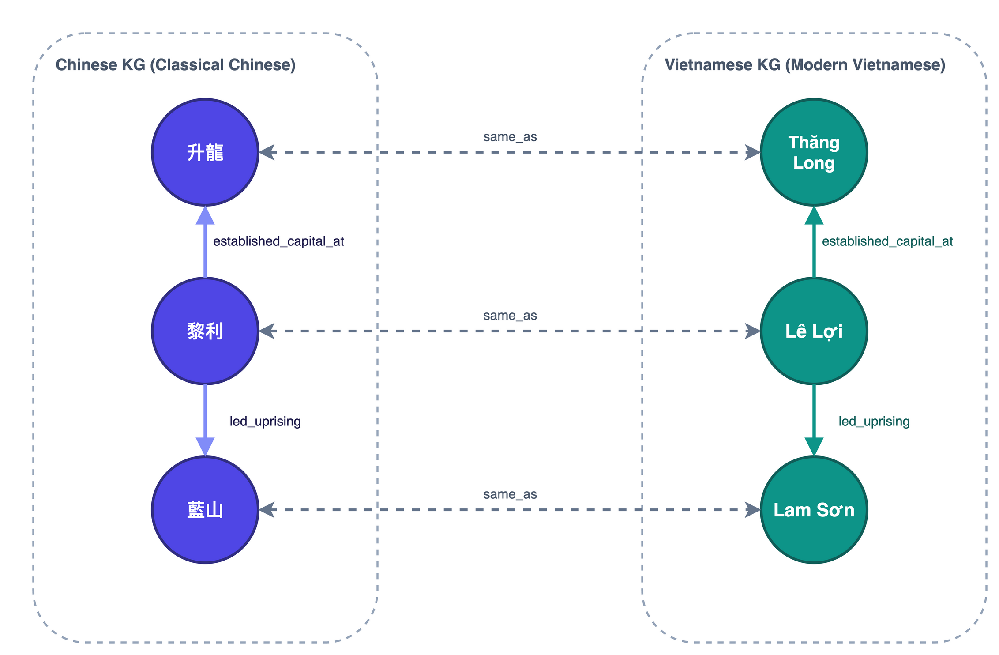
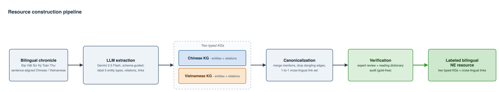
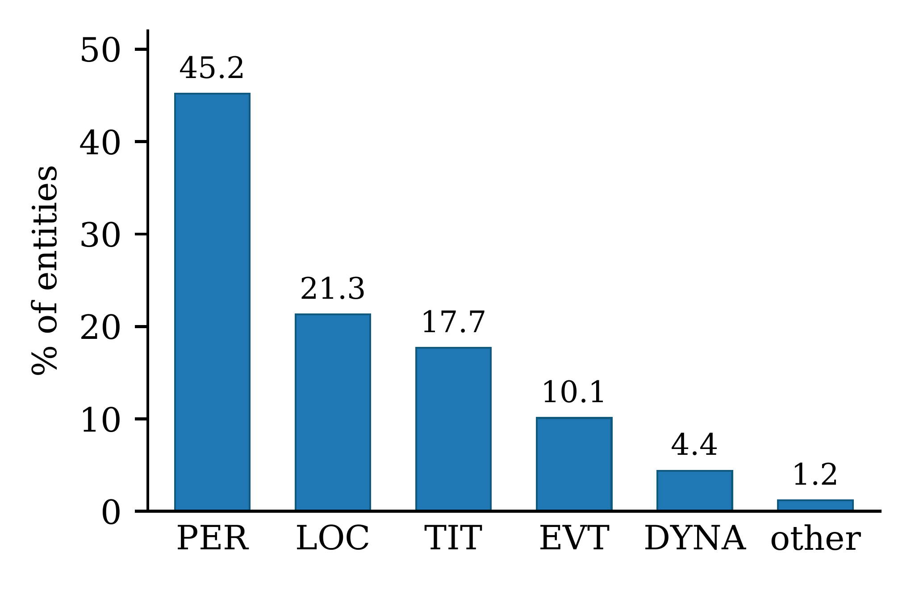
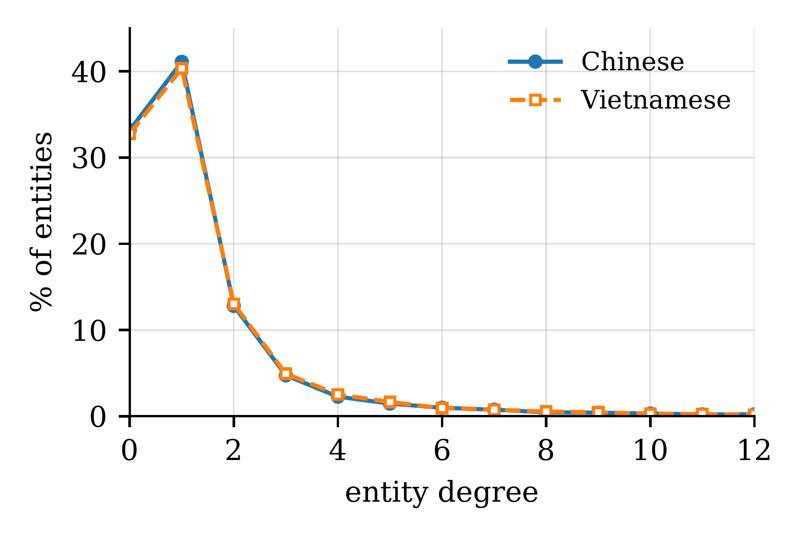

**English** | [Tiếng Việt](README.vi.md)

# Code for the VCL2026 paper

Code accompanying the paper *LLM-Based Named-Entity Recognition and Knowledge Graph Construction
for Sino-Vietnamese Feudal History*. It reproduces the whole pipeline and every number in
Sections 3–4 of the paper: extraction with Gemini 2.5 Flash, canonicalization, the gold-free
audit, evaluation against a three-annotator gold, capture–recapture, the supervised baselines,
and the expert judgments.

## 1. Overview

The resource consists of two typed knowledge graphs built from the bilingual chronicle
*Đại Việt Sử Ký Toàn Thư*, one in Classical Chinese and one in Vietnamese, joined by
cross-lingual links between mentions of the same referent (e.g., 黎利 ↔ Lê Lợi).



*Figure 1. Solid arrows are within-graph relations; dashed `same_as` links are the cross-lingual
equivalences. Many Vietnamese names are Sino-Vietnamese readings of the Chinese forms
(升龍 → Thăng Long), which the gold-free audit uses to check the links.*

The pipeline runs in one pass over the chronicle:



*Figure 2. Gemini 2.5 Flash reads each aligned sentence pair under a fixed schema and labels five
entity types (PER, LOC, TIT, EVT, DYNA), relation triples, and cross-lingual links on each side.
The two graphs are canonicalized, the links are reduced to a one-to-one set, and the result is
checked by experts and by a gold-free reading-dictionary audit.*

| Step | Paper section | Code |
|---|---|---|
| Sentence-pair splitting and LLM extraction | 3.2 | `sino_viet_kg/extraction/` |
| Canonicalization and one-to-one link set | 3.3–3.4 | `sino_viet_kg/canonicalization.py` |
| Resource statistics | 4.1–4.2 | `sino_viet_kg/resource_stats.py` |
| Gold-free audit | 3.5, 4.3 | `sino_viet_kg/audit/` |
| Human gold, capture–recapture, baselines, expert judgments | 4.4–4.6 | `sino_viet_kg/evaluation/` |

## 2. Results

All numbers below are the paper's results; the command under each part reproduces them
(data requirements are in Section 4).

### 2.1. Example: one sentence pair through the pipeline (Table 1)

Input (pair `3-2`):

> 神農氏之後帝明得鶩僊女而生涇陽王是爲百粤始祖。
>
> Con cháu Thần Nông thị là Đế Minh lấy con gái Vụ Tiên mà sinh Kinh Dương Vương, tức là thuỷ tổ của Bách Việt.

LLM output (one JSON record per pair):

| | Chinese | Vietnamese |
|---|---|---|
| PER | 神農氏, 帝明, 鶩僊女, 涇陽王 | Thần Nông thị, Đế Minh, Vụ Tiên, Kinh Dương Vương |
| LOC | 百粤 | Bách Việt |
| Triples | (帝明, descendant_of, 神農氏); (帝明, spouse_of, 鶩僊女); (帝明, father_of, 涇陽王); (涇陽王, other_relation, 百粤) | same four triples on the Vietnamese side |
| Links (confidence) | 神農氏↔Thần Nông thị (1.0); 帝明↔Đế Minh (1.0); 鶩僊女↔Vụ Tiên (0.90); 涇陽王↔Kinh Dương Vương (1.0); 百粤↔Bách Việt (1.0) | |

Output after canonicalization (global integer ids; Vietnamese ids start at 14,719):

```text
entities (zh): 73 神農氏, 30 帝明, 33 鶩僊女, 74 涇陽王, 10 百粤
entities (vi): 14792 thần nông thị, 14750 đế minh, 14753 vụ tiên, 14793 kinh dương vương, 14728 bách việt
relations:     15 descendant_of, 20 father_of, 37 other_relation, 53 spouse_of
triples (zh):  30 15 73 | 30 53 33 | 30 20 74 | 74 37 10      (head rel tail)
links:         (73, 14792) (30, 14750) (33, 14753) (74, 14793) (10, 14728)
```

### 2.2. Resource statistics (Table 2, Figures 3–4)

Command: `python3 -m sino_viet_kg.canonicalization` then `python3 -m sino_viet_kg.resource_stats`

| Statistic | Chinese | Vietnamese |
|---|---:|---:|
| Entities | 14,719 | 14,094 |
| Triples | 11,666 | 11,698 |
| Average degree | 1.59 | 1.66 |
| Relation types | 62 | 62 |
| Isolated entities | ≈ 33% | ≈ 33% |
| Cross-lingual links (one-to-one) | 12,353 | 12,353 |

Canonicalization merges 75,732 raw mentions into 28,813 entities (2.6:1), removes 522 / 505
dangling triples, and reduces 35,716 raw link proposals (15,457 unique candidates) to 12,353
one-to-one links.

| Label composition (Figure 3) | Entity-degree distribution (Figure 4) |
|---|---|
|  |  |
| Persons dominate (45.2%), then locations (21.3%) and titles (17.7%); the five in-schema types cover 98.8% of mentions. | About one third of entities have degree 0 and over 40% have degree 1: per-sentence extraction yields a sparse graph. |

### 2.3. Gold-free audit (Table 3)

Command: `python3 -m sino_viet_kg.audit.run_all` (writes `results/audit/05_summary/table3.md`).
Computed over the full extraction before canonicalization (20,867 sentence pairs); uses only the
reading dictionary, no gold labels and no embeddings.

| Check | Result |
|---|---:|
| Entity grounding | 97.5% |
| Label validity | 98.8% |
| Label consistency | 94.8% |
| Predicate validity | 99.5% |
| Triple-ID integrity | 96.1% |
| Entity recall (capture–recapture, Section 2.5) | 98.2% |
| Links phonetically confirmed (dictionary) | 68.8% |
| Proxy precision (dictionary oracle) | 98.8% |
| Proxy recall miss | 1.3% |
| Alignment symmetry (zh / vi) | 94.5 / 93.9% |
| Triple parallelism (zh / vi) | 98.0 / 98.6% |

The reading dictionary is `hanviet.csv` with Unihan `kVietnamese` readings as a fallback;
Unihan alone would confirm only 45.0% of the links.

### 2.4. Human gold evaluation (Tables 4–5)

Command: `python3 -m sino_viet_kg.evaluation.eval_ner`. Three annotators relabel a stratified
sample of 400 sentence pairs; an entity is gold when at least two of three mark it.

| Type | P | R | F1 |
|---|---:|---:|---:|
| PER | 0.899 | 0.998 | 0.946 |
| LOC | 0.933 | 0.961 | 0.947 |
| TIT | 0.881 | 0.948 | 0.913 |
| EVT | 0.963 | 0.988 | 0.975 |
| DYNA | 0.985 | 0.931 | 0.957 |
| **Micro (all)** | **0.899** | **0.978** | **0.937** |

- Confusion counts: TP = 1,313, FP = 147, FN = 30; micro F1 95% CI [0.919, 0.953]; macro F1 0.948.
- By side: Chinese 0.966, Vietnamese 0.907.
- Inter-annotator agreement (exact-match mention F1 per pair): a–b 0.970, a–c 0.795, b–c 0.820, mean 0.861.

### 2.5. Capture–recapture recall (Section 4.5)

Command: `python3 -m sino_viet_kg.evaluation.capture_recapture gold` (400 gold pairs) and
`... capture_recapture corpus` (1,200-pair sample). Extractor A is Gemini 2.5 Flash, extractor B
is Gemini 2.5 Pro; N̂ = N_A·N_B / N_AB and recall_A = N_AB / N_B.

| Sample | N_A | N_B | N_AB | N̂ | Estimated recall |
|---|---:|---:|---:|---:|---:|
| 400 gold pairs | 1,460 | 1,380 | 1,350 | 1,492.4 | 0.9783 (gold: 0.9777) |
| 1,200-pair corpus sample | 4,149 | 3,899 | 3,830 | 4,223.7 | 0.982 [0.978–0.986] |

Both extractors are Gemini models, so their errors are likely correlated and the recall is an
upper bound.

### 2.6. Quality across the four KG layers (Table 6)

| Layer | Metric (method) | Score | Command |
|---|---|---:|---|
| Entities | micro F1 vs. gold | 0.937 | `evaluation.eval_ner` |
| Entities | recall, capture–recapture | 0.982 | `evaluation.capture_recapture corpus` |
| Entities | supervised baseline (zh / vi) | 0.632 / 0.605 | `evaluation.baselines.zh_sikubert`, `...vi_phobert` |
| Links | precision, non-phonetic | 0.953 | `evaluation.triple_link_precision` |
| Relations | triple precision (expert) | 0.735 | `evaluation.triple_link_precision` |
| Canonicalization | cluster purity (expert) | 0.762 | `evaluation.canon_purity` |

Details behind the table:

| Baseline per type (F1) | PER | LOC | TIT | EVT | DYNA | Micro |
|---|---:|---:|---:|---:|---:|---:|
| SikuBERT (zh, character BIO) | 0.700 | 0.744 | 0.487 | 0.426 | 0.746 | 0.632 |
| PhoBERT (vi, word BIO) | 0.791 | 0.635 | 0.330 | 0.382 | 0.575 | 0.605 |

- Links: 0.914 on the ambiguous subset, 0.953 [0.907–0.977] over all non-phonetic links.
- Triples: 0.735 [0.670–0.791] on 200 triples; 0.767 for the 24 schema predicates, 0.640 off-schema.
- Purity: 0.762 [0.659–0.842] on 80 clusters; PER 0.857, LOC 0.944, DYNA 1.0, TIT 0.333, EVT 0.333
  (recurring offices and sexagenary dates collapse into type-like nodes).

## 3. Installation

Requires Python 3.9 or later.

```bash
cd code
python3 -m venv .venv
source .venv/bin/activate          # Windows: .venv\Scripts\activate
pip install -r requirements.txt
```

All commands below are run from the `code/` directory.

## 4. Data

### 4.1. Shipped with the code

`data/dictionary/`: the Sino-Vietnamese reading list `hanviet.csv` and the `kVietnamese` lines of
Unihan (Unicode 17.0.0), used by the gold-free audit. `data/` also contains the annotation
guideline (`data/gold/ANNOTATION_GUIDE.md`) and the Gemini 2.5 Pro prompt
(`data/capture_recapture/prompt_gemini_pro_extraction.md`).

### 4.2. Annotation data (available on request)

The three annotators' gold sheets, the expert judgment sheets, and the Gemini 2.5 Pro inputs and
outputs contain sentences of the CLC corpus, so they are not distributed with the code; contact
the author to obtain them. Copy them to:

| Directory | Files |
|---|---|
| `data/gold/` | `annotator_a.csv`, `annotator_b.csv`, `annotator_c.tsv`, `gold_majority_vote.tsv`, `llm_predictions.json`, `annotation_worksheet_blank.tsv`, `sample_manifest.json` |
| `data/capture_recapture/` | `input_gold_400_pairs.jsonl`, `gemini_pro_output_gold_400_pairs.json`, `input_corpus_sample_1200_pairs.jsonl`, `gemini_pro_output_corpus_sample_1200_pairs.json` |
| `data/triple_link_precision/` | `triples_human_judged.csv`, `hard_links_auto_confirmed.csv`, `hard_links_human_judged.csv` |
| `data/canon_purity/` | `canonical_clusters_human_judged.csv` |

### 4.3. CLC corpus (available on request)

The bilingual Đại Việt Sử Ký Toàn Thư corpus is provided by the Computational Linguistics Center
(CLC), University of Science, VNU-HCM, for research use; resources derived from it are not
redistributed either. Once you have the corpus, place the file at:

```
code/corpus/0_source/DVSKTT_aligned_at_sentence_level_20240520_concat_full_aligned_clc_preprocessed_manual_version.xlsx
```

To keep it elsewhere, point the environment variable `VCL_CORPUS_DIR` to the directory that
contains `0_source/`:

```bash
export VCL_CORPUS_DIR=/path/to/corpus
```

The steps in Section 5.2 create `corpus/1_sentence_pairs/` (sentence pairs) and
`corpus/2_llm_output/gemini-2.5-flash/` (extraction output). The extraction step needs an API key:

```bash
echo "GEMINI_API_KEY=<your key>" > .env
```

## 5. Running

### 5.1. With the annotation data (Section 4.2)

| Paper content | Command | Expected result |
|---|---|---|
| Tables 4–5, IAA (Sections 4.4–4.5) | `python3 -m sino_viet_kg.evaluation.eval_ner` | micro F1 0.937 [95% CI 0.919–0.953], mean IAA 0.861 |
| Capture–recapture on the 400 gold pairs (Section 4.5) | `python3 -m sino_viet_kg.evaluation.capture_recapture gold` | estimated recall 0.9783, recall against gold 0.9777 |
| Triple and link precision (Section 4.6) | `python3 -m sino_viet_kg.evaluation.triple_link_precision` | triples 0.735 (closed / off-schema 0.767 / 0.640); links 0.914 / 0.953 |
| Canonicalization purity (Section 4.6) | `python3 -m sino_viet_kg.evaluation.canon_purity` | 0.762 |

### 5.2. With the CLC corpus (Section 4.3)

Run in order. Step 6 also needs the capture–recapture data, and step 7 also needs
`data/gold/gold_majority_vote.tsv` (Section 4.2).

| Step | Paper content | Command | Expected result |
|---|---|---|---|
| 1 | Sentence-pair splitting | `python3 -m sino_viet_kg.extraction.sentence_pairs` | 2,578 rows, 20,867 sentence pairs |
| 2 | Extraction (Section 3.2) | `python3 -m sino_viet_kg.extraction.run` | 20,867 records |
| 3 | Canonicalization (Sections 3.3–3.4) | `python3 -m sino_viet_kg.canonicalization` | 14,719 / 14,094 entities; 15,457 candidates, 12,353 one-to-one links |
| 4 | Table 2, Figures 3–4 (Sections 4.1–4.2) | `python3 -m sino_viet_kg.resource_stats` | average degree 1.59 / 1.66 |
| 5 | Table 3 (Section 4.3) | `python3 -m sino_viet_kg.audit.run_all` | table written to `results/audit/05_summary/table3.md` |
| 6 | Capture–recapture on 1,200 pairs (Section 4.5) | `python3 -m sino_viet_kg.evaluation.capture_recapture corpus` | recall 0.982 [95% CI 0.978–0.986] |
| 7 | Baselines (Section 4.6) | `python3 -m sino_viet_kg.evaluation.baselines.zh_sikubert` then `python3 -m sino_viet_kg.evaluation.baselines.vi_phobert` | micro F1 0.632 / 0.605 |

Notes:

- Step 2 calls the API and incurs cost. Check the configuration first with `--dry-run` and try a
  small run with `--limit 40`. Results are cached by content, so rerunning the same command after
  an interruption continues where it stopped. Because LLM output is not deterministic, a new run
  may differ slightly from the paper's run; steps 3–7 reproduce the paper's numbers when run on
  the paper's extraction output (available on request together with the corpus).
- Step 7 should run on a GPU or Apple MPS; add `--cpu` for PhoBERT if memory is short.
- To redraw the 400-pair gold sample (seed 13): `python3 -m sino_viet_kg.evaluation.sample_gold --out <dir>`.

Code comments and console output are in Vietnamese.

## 6. Code layout

| Path | Contents |
|---|---|
| `sino_viet_kg/extraction/` | Sentence-pair splitting; Gemini 2.5 Flash calls in batches of 20 pairs, temperature 0.1, JSON mode; content-addressed cache |
| `sino_viet_kg/canonicalization.py` | Merges mentions into canonical entities, removes dangling triples, reduces links to a one-to-one set |
| `sino_viet_kg/resource_stats.py` | Table 2 statistics, label composition, degree distribution |
| `sino_viet_kg/audit/` | Gold-free audit: grounding, schema, reading dictionary, bilingual consistency |
| `sino_viet_kg/evaluation/` | Gold evaluation, capture–recapture, baselines, expert judgments |
| `sino_viet_kg/paths.py` | All data paths |
| `configs/gemini-2.5-flash.json` | Extraction parameters |
| `prompts/ner_with_relations.md` | Full extraction prompt, verbatim as run |
| `results/` | The paper's NER and baseline results (numbers only); reruns also write here (change with `VCL_RESULTS_DIR`) |
| `docs/figures/` | Figures 1–4 of the paper used in this README |
